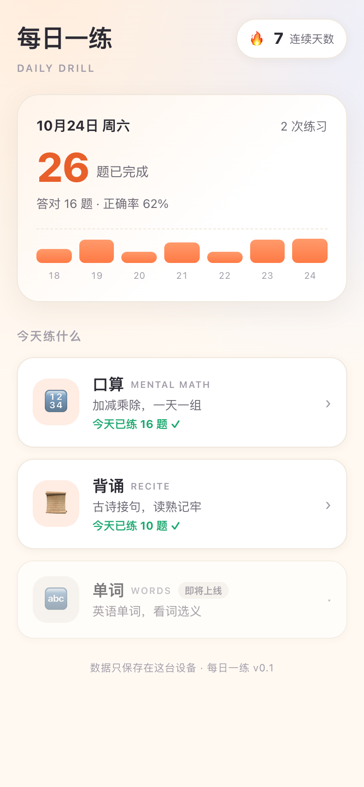

# 每日一练 · Daily Drill

给小学生每天用的轻量练习应用。做题、记账、看连续天数——不注册、不联网、不上传任何数据。

**线上地址：<https://dodio.github.io/daily-drill/>**

纯前端，所有练习记录存在浏览器 `localStorage` 里。



## 技术栈

| 层 | 选择 | 说明 |
| --- | --- | --- |
| 构建 | Vite 8 | 和同目录的 keyboard-learn 保持同一代工具链 |
| 框架 | React 19 + TypeScript | strict 模式，`verbatimModuleSyntax` |
| 路由 | 自写 hash 路由（`src/lib/router.ts`） | 零依赖；纯静态托管刷新任意路径不 404 |
| 样式 | 原生 CSS + CSS 变量 | 无 UI 库；`index.css` 里统一管理设计 token，自带暗色适配 |
| 数据 | localStorage | 带 `version` 字段，未来换后端只需替换 `src/lib/storage.ts` |

## 目录结构

```
src/
├── main.tsx                  入口
├── App.tsx                   路由表
├── index.css                 设计 token + 全部样式
├── types/index.ts            全局类型（SessionRecord 是持久化核心）
├── data/
│   ├── subjects.ts           科目注册表（新增科目从这里入手）
│   └── poems.ts              统编版一、二年级古诗文（30 篇，按年级 + 上下册）
├── lib/
│   ├── router.ts             hash 路由
│   ├── storage.ts            localStorage 读写与容错
│   ├── prefs.ts              上次选的参数（难度/题型/年级/册），与记录分开存
│   ├── stats.ts              今日汇总 / 连续打卡 / 7 天趋势
│   ├── date.ts               本地时区日期工具
│   └── id.ts                 唯一 id（局域网 http 下 randomUUID 降级）
├── store/
│   └── DailyLogProvider.tsx  全局练习数据 Context
├── components/               跨模块复用组件
│   ├── Numpad.tsx
│   ├── ResultCard.tsx
│   ├── SubjectCard.tsx
│   └── StreakBadge.tsx
├── modules/                  每个科目一个目录，互相独立
│   ├── math/                 口算
│   │   ├── MathPage.tsx      页面编排：setup → quiz → result
│   │   ├── MathSetup.tsx     难度 / 题型（可多选）/ 练法（按题数 or 按时间）
│   │   ├── MathQuiz.tsx      答题（数字键盘 + 物理键盘；限时模式带倒计时）
│   │   └── generator.ts      题目生成
│   └── recite/               背诵
│       ├── RecitePage.tsx
│       ├── ReciteSetup.tsx
│       ├── ReciteQuiz.tsx
│       └── generator.ts      接句题 + 干扰项
└── pages/
    ├── Home.tsx
    └── NotFound.tsx
```

## 开发

```bash
npm install
npm run dev        # http://localhost:5173
npm run build      # tsc 类型检查 + 打包到 dist/
npm run preview    # 本地预览构建产物
npm run typecheck  # 只做类型检查
```

手机/平板联调：`npm run dev -- --host`，用同一局域网 IP 访问。

## 部署

推送到 `main` / `master` 后，GitHub Actions 自动构建并发布到 GitHub Pages（见 `.github/workflows/deploy.yml`）。

- **线上地址：<https://dodio.github.io/daily-drill/>**
- 仓库名是 `daily-drill`，站点挂在 `/<仓库名>/` 子路径下，构建时由 workflow 注入 `VITE_BASE` 保证资源路径正确
- 想绑独立域名 → 去掉 workflow 里的 `VITE_BASE` 环境变量（让 `base` 回到 `/`），并在 `public/` 放 `CNAME` 文件

## 数据模型

一次练习存成一条 `SessionRecord`：

```ts
{
  id, subject, date,        // date 是本地时区 YYYY-MM-DD，按天聚合靠它
  startedAt, durationMs,
  total, correct,
  mode,                     // 'count' | 'timed'，可选；旧记录没有此字段，按按题数处理
  wrongItems: [{ prompt, yourAnswer, correctAnswer }]
}
```

首页的「今日题数」「连续天数」「7 天趋势」全部由这个数组派生，不额外存冗余状态。
连续天数的规则：**今天还没练不打断连续**，避免早上打开就看到归零。

## 出题规则

### 口算

数字全部由 `Math.random()` 现场生成，没有预置题库，所以同一组参数每次的题目都不一样。

| 难度 | 加法 | 减法 | 乘法 | 除法 |
| --- | --- | --- | --- | --- |
| 一年级 · 20 以内 | 和 ≤ 20 | 被减数 ≤ 20，结果非负 | 2~5 × 2~5 | 除数 2~5，商 2~4，整除 |
| 二年级 · 100 以内 | 和 ≤ 100 | 同上 | 2~9 × 2~9 | 除数 2~9，商 2~9，整除 |
| 三年级+ · 多位 | 和 ≤ 1000 | 同上 | 11~99 × 2~9 | 商 11~50，整除 |

除法用逆运算构造（先定除数和商，再乘出被除数），保证永远整除、不出现余数；减法先定被减数再定减数，保证结果非负。

**去重是软的**，分三步：

1. 先按「同题只出一次」铺开
2. 题库不够时放宽到「每题最多 2 次」，还不够就 3 次、4 次……上限 8 次
3. 任何情况下都不让同一道题紧挨着出现

之所以要放宽，是因为低年级题库本来就不大：一年级乘法只有 10 道本质不同的题（2~5 的乘法口诀），设 20 题时死守去重会只出 10 道就结束。与其少给题，不如让这十道各练两遍。

**乘法和加法按交换律判重**：`3 × 8` 和 `8 × 3` 记作同一道。不做这一步的话，表内乘法 64 种写法里其实只有 36 道不同的题，其余全是换了顺序的重复。

### 背诵

从所选「年级 + 册」的篇目里抽篇，每篇按诗句顺序出「上一句 → 下一句」的接句题（n 句出 n−1 题）。

- **全部混合**：把所有篇目的接句题洗牌后取前 10 道
- **指定单篇**：该篇的接句题全部出完（4 句古诗 → 3 题）
- **干扰项**：三个错误选项只从**同一册**的其他诗句里抽。跨年级混进来的句子风格差异太大，一眼就能排除，题目会变水
- 错误选项会同时排除正确答案和题干本身，不会出现「选自己」
- 选中的篇目若不属于当前年级/册（比如改了年级），自动退回「全部混合」

诗词数据取自统编版（部编版）教材要求背诵的篇目，共 30 篇：一年级上册 6 篇、一年级下册 7 篇、二年级上册 8 篇、二年级下册 9 篇。除古诗外也收了「日积月累」里成段的传统韵文（数九歌、二十四节气歌、弟子规节选）。只收教材原文，不做扩写；现代白话课文原文涉及版权，未收录。

## 记住上次的选择

难度、题型、练法、题数/时长、背诵的年级和册，全部写进 `localStorage`，下次进来直接是上次那套参数。

键名统一 `daily-drill:pref:*`，和练习记录分开存——记录丢了只是少一条历史，偏好丢了每次都得多点几下，两者不该互相牵连。读出来的值逐项校验，旧版本或被手改过的数据不合格就退回默认值。

## 怎么加一个新科目

以「英语单词」为例：

1. `src/data/subjects.ts` 里把 `words` 的 `ready` 改成 `true`
2. 新建 `src/modules/words/`，照 `math` 的结构写 `WordsPage / WordsSetup / WordsQuiz / generator`
3. `src/App.tsx` 加一条 `case '/words'`
4. 数据（词表）放 `src/data/words.ts`

`SessionRecord.subject` 是 `SubjectId` 联合类型，加科目时记得扩 `src/types/index.ts`。

## 路线图

- [x] 口算：加减乘除、三档难度、数字键盘
- [x] 口算限时模式：2 / 5 / 10 分钟，时间内统计答对答错与每分钟题数
- [x] 背诵：古诗接句四选一
- [x] 背诵按年级 + 上下册分册，一、二年级 30 篇
- [x] 记住上次选的参数（难度/题型/年级/册）
- [ ] 英语单词（看词选义）
- [ ] 错题本：跨天沉淀、只练错题
- [ ] 家长视角：一周汇总
- [ ] 可选的后端同步（多设备）
